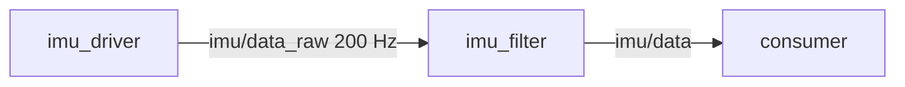

# Plan template (PLAN-003)

Copy to `docs/plans/YYYY-MM-DD-<slug>.md`. Delete guidance lines in `<...>`.
Tables over prose. Everything must be specific enough to check code against.

```markdown
# <Feature / system name>

- Status: proposed | approved | in progress | done | abandoned
- Date: YYYY-MM-DD   Author: <agent/model + human owner>
- Related: <issues, decisions docs/decisions/NNNN, previous plans>

## 1. Goal
<2–4 sentences: what the robot/system can do when this is done, and for whom.>

### Success criteria
- <measurable: "picks a box from the infeed in < 20 s, 95 % of 50 sim trials">

### Non-goals
- <what this plan deliberately does not do>

## 2. Context
<What exists already (packages, contracts, upstream stacks) and what constrains us:
hardware, sim vs real, compute (GPU?), DEVENV, decisions from docs/decisions/.>

## 3. Requirements
| ID | Requirement | Budget / threshold | Verified at level |
|---|---|---|---|
| R1 | <functional> | | L2/L3 |
| R2 | <rate / latency> | e.g. imu/data 190–210 Hz, < 5 ms | L3/L6 |
| R3 | <safety: timeout -> safe state> | stop within 0.5 s | L2/L5 |

## 4. Options considered
| Criterion | A: <name> | B: <name> | C: <name> |
|---|---|---|---|
| fits requirements | | | |
| latency / throughput | | | |
| failure modes / robustness | | | |
| testability | | | |
| scales to N instances | | | |
| effort | | | |

**Recommendation: <X>**, because <...>. <B> loses because <...>.

## 5. Design
### Packages
| Package | Domain folder | Role (taxonomy) | Template | New/changed |
|---|---|---|---|---|

### Nodes and contracts
<One subsection per node: responsibility (one sentence), lifecycle yes/no, language,
and the draft contract.yaml (publishes/subscribes/services/actions/parameters with QoS,
rates, latency).>

### Interfaces
<New msg/srv/action definitions with fields, units, constants. Justify each new
type against standard ones (IF-002).>

### Data flow


### Bring-up
<Entity bringups, layout entries, lifecycle order/manager, launch arguments, panes.list lines.>

### Environment impact
<New apt/rosdep deps, container image changes, external/ entries, RMW config.>

## 6. Verification plan
| Level | What is tested | Exit criterion (command → expected) |
|---|---|---|
| L0 | static | `tools/check.sh --packages ...` → CHECK: PASS |
| L1 | core units: <list> | coverage ≥ COVERAGE_MIN_LINES |
| L2 | per node: lifecycle, params, data, input loss | node tests pass |
| L3 | integration steps: <A>, <A+B>, <A+B+C> | launch tests + `contracts.py graph` |
| L4 | replay: <bags> | outputs within tolerance of golden |
| L5 | sim scenarios: <list> | pass criteria |
| L6 | hardware acceptance: <list> | budgets met |

## 7. Milestones
| # | Deliverable | Integrates with | Exit criteria | Done |
|---|---|---|---|---|
| M1 | | — | | [ ] |
| M2 | | M1 | | [ ] |

## 8. Risks
| Risk | Likelihood | Impact | Mitigation / early test |
|---|---|---|---|

## 9. Open questions
- <question> — proposed default: <...>

## 10. Decisions to record
- <decision> → docs/decisions/NNNN-<slug>.md
```
